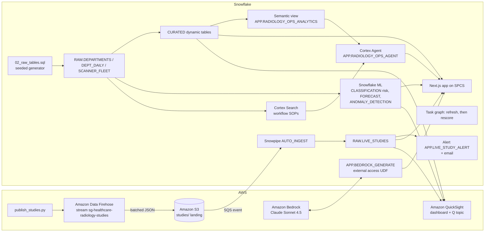

# Singapore Radiology Department Operations - Turnaround, Backlog and Breach Risk

End-to-end operations analytics for **40 imaging departments of Harbourline Imaging, a fictional Singapore imaging network, across 5 planning areas** (Novena, Jurong East, Tampines, Queenstown and Woodlands) using Snowflake, optionally with AWS: from a live worklist alert to a 7-day priority-study turnaround (TAT) breach risk score, an alert email and an AI action memo for the radiology operations team. All data is synthetic and department-level: there are no patient records, no images, no report text and no clinical findings.

## Architecture

A radiology operations pipeline built on **Snowflake** (Dynamic Tables, Snowflake ML, Cortex Search, Cortex Agent, Cortex AI_COMPLETE, SPCS) and, in the full build, **AWS** (Amazon Data Firehose, S3, Bedrock Claude, QuickSight + Amazon Q). Study-status events land in `RAW.LIVE_STUDIES`. Dynamic tables curate 90 days of department-day history: studies completed against plan, reports finalised inside the TAT target, worklist escalations, confirmed priority-study TAT breaches, breach reviews, unread backlog and scanner QA compliance. Snowflake ML scores 7-day TAT breach risk per department, forecasts reports finalised in target and flags report turnaround anomalies. A Cortex Agent answers questions with SOP citations, and an LLM drafts the radiology operations action memo.

Interactive diagrams (hover for object names): [Snowflake only](docs/architecture-snowflake.html) | [AWS + Snowflake](docs/architecture-aws.html). The app shows both on its Architecture & Data tab, the current build first. Regenerate them with `python3 docs/build_architecture.py`.



The Snowflake-only build drops the AWS subgraph: `APP.SIMULATE_STUDIES` writes to `RAW.LIVE_STUDIES`, and the app calls Cortex `AI_COMPLETE` instead of the Bedrock UDF.

## Snowflake Capabilities

| Capability | Implementation |
|-----------|---------------|
| Dynamic Tables | `CURATED.KPI_SUMMARY`, `PERFORMANCE_SUMMARY`, `DRIVER_SUMMARY`, `TREND_ANALYSIS` from the RAW tables |
| Snowflake ML | CLASSIFICATION 7-day priority-study TAT breach risk (`ML.BREACH_RISK_SCORES`), 14-day FORECAST of reports finalised in target, report turnaround ANOMALY_DETECTION |
| Cortex Search | 14 synthetic radiology workflow SOPs (one per department type and delay driver) in `SEARCH.DEPT_SOP_SEARCH` |
| Semantic View | `APP.RADIOLOGY_OPS_ANALYTICS` over departments, delay drivers, daily totals and risk |
| Cortex Agent | `APP.RADIOLOGY_OPS_AGENT`: Cortex Analyst over the semantic view plus Cortex Search for SOP citations |
| Cortex AI | `AI_COMPLETE('claude-sonnet-4-5')` for grounded answers, and for the action memo in the Snowflake-only build |
| Alerts + Tasks | `APP.LIVE_STUDY_ALERT` logs ALERT events and sends email; task graph `TASK_REFRESH_CURATED`, then `TASK_RESCORE_RISK` |
| Snowpark Container Services | Next.js app `APP.SG_HEALTHCARE_RADIOLOGY_APP` with 6 tabs: Executive Cockpit, Predictive, Workflow Risk, Live Studies, Ask AI, Architecture & Data |
| Snowpipe | `RAW.LIVE_STUDIES_PIPE` AUTO_INGEST from S3 (AWS build only) |

## AWS Services

Used only in the AWS + Snowflake build.

| Service | Role in Demo |
|---------|-------------|
| Amazon Data Firehose | Direct PUT stream `sg-healthcare-radiology-studies` receives simulated study-status events and writes batches to S3 |
| Amazon S3 | Landing bucket (`studies/`). An event notification goes to the Snowpipe SQS queue |
| Amazon Bedrock | Claude Sonnet 4.5 writes the action memo, called from Snowflake through an external-access UDF |
| Amazon QuickSight | DIRECT_QUERY executive dashboard over Snowflake (daily studies and escalations, confirmed TAT breaches by department, breach risk) |
| Amazon Q | Natural-language questions over the QuickSight topic `sg-healthcare-radiology-topic` |
| AWS IAM | Least-privilege roles for S3, Firehose and Bedrock |

## Personas

These personas are fictional.

| Persona | Role | Key Questions |
|---------|------|---------------|
| **Farah Iskandar** | Director of Radiology Operations, Harbourline Imaging | "Are our Singapore departments reporting inside their turnaround targets?" "Which delay drivers turn into confirmed breaches?" |
| **Marcus Seah** | Radiology Workflow Lead, Harbourline Imaging | "Which departments and planning areas are high risk this week, and which SOP applies?" |

## Data

All data is synthetic and seeded, so every rebuild reproduces it. Harbourline Imaging, its departments and the personas are fictional; the planning areas are real Singapore place names used only as locations. Tables hold department-level daily counts only: there are no patient records, no patient identifiers, no images, no report text and no clinical findings, and nothing in this demo is a diagnostic, clinical-accuracy or medical-efficacy claim.

| Table | Rows | Description |
|-------|------|-------------|
| RAW.DEPARTMENTS | 40 | Imaging departments across 5 Singapore planning areas and 5 department types (Emergency, Inpatient, Outpatient, Cancer centre, Community), with service tier, reader FTE and 90-day study plan |
| RAW.DEPT_DAILY | 3,600 | Daily department operations over 90 days: studies completed and reported in target, worklist escalations, confirmed priority TAT breaches, breach reviews, delay driver, scanner QA checks, report turnaround and unread backlog |
| RAW.SCANNER_FLEET | 40 | Modality, scanners installed, QA-certified and pending certification per department |
| SEARCH.DEPT_SOP_DOCS | 14 | Synthetic radiology workflow SOPs indexed for Cortex Search |
| RAW.LIVE_STUDIES | Grows during the demo | Live study-status events from Firehose (AWS build) or `APP.SIMULATE_STUDIES` (Snowflake-only build) |
| ML.BREACH_RISK_SCORES | 40 | 7-day TAT breach probability and risk band per department |

## Build Instructions

### Prerequisites
- Snowflake account with ACCOUNTADMIN access, and Cortex AI enabled (AI_COMPLETE, Search, Agent).
- An X-Small warehouse with auto-suspend at or below 120 s, and an existing SPCS compute pool.
- Python 3.11+, `snowflake-connector-python`, Node.js 22+, Docker and the `snow` CLI.
- App image: run `snow spcs image-registry login`, then build and push `sg-healthcare-radiology-app:v1` to the database's `APP.IMAGES` repository (see the header of `snowflake/07_deploy_app.sql`).
- AWS build only: `boto3`, AWS credentials for the target account (us-west-2) with Bedrock access, and QuickSight Enterprise.

### SPCS App
```
<DATABASE>.APP.SG_HEALTHCARE_RADIOLOGY_APP
```

### Tests
```bash
python -m pytest aws snowflake quicksight
```

For a local run, put `SNOWFLAKE_ACCOUNT`, `SNOWFLAKE_USER`, `SNOWFLAKE_DATABASE`, `SNOWFLAKE_WAREHOUSE`, `SNOWFLAKE_AUTHENTICATOR=PROGRAMMATIC_ACCESS_TOKEN`, `SNOWFLAKE_TOKEN` and `DEMO_PLATFORM` in the environment, then run `npm --prefix app run build && npm --prefix app start`.

## Build Modes

Both modes share the same core. They differ in three places, and the app's `DEMO_PLATFORM` setting (in its SPCS spec) switches the memo provider and the Live Studies tab.

| Layer | Snowflake Only | Full AWS + Snowflake |
|---|---|---|
| Live study status | `CALL APP.SIMULATE_STUDIES(n)` inserts simulated study-status events into `RAW.LIVE_STUDIES`. This simulates a RIS worklist feed; it is not Snowpipe Streaming | `aws/publish_studies.py` to Amazon Data Firehose, then S3, SQS and Snowpipe AUTO_INGEST |
| Action memo | Cortex `AI_COMPLETE('claude-sonnet-4-5')` | Amazon Bedrock Claude Sonnet 4.5 through `APP.BEDROCK_GENERATE` |
| BI and natural-language questions | The SPCS app is the dashboard; questions go to the Cortex Agent | Also a QuickSight dashboard and an Amazon Q topic |
| App setting | `DEMO_PLATFORM: snowflake` | `DEMO_PLATFORM: aws` |

### Snowflake Only

```bash
# 1. Core data and dynamic tables (guarded: new isolated database only)
python snowflake/run_core.py --database SINGAPORE_HEALTHCARE_RADIOLOGY_SNOWFLAKE --warehouse <XS_WAREHOUSE> --connection <CONNECTION> --apply
# 2. Native study-status feed, ML, search, semantic view, agent, alert and task graph
python snowflake/run_intelligence.py --database SINGAPORE_HEALTHCARE_RADIOLOGY_SNOWFLAKE --platform snowflake --warehouse <XS_WAREHOUSE> --connection <CONNECTION> --alert-email you@example.com
# 3. App on SPCS with DEMO_PLATFORM=snowflake (push the image first)
python snowflake/run_intelligence.py --database SINGAPORE_HEALTHCARE_RADIOLOGY_SNOWFLAKE --platform snowflake --warehouse <XS_WAREHOUSE> --connection <CONNECTION> --alert-email you@example.com --files 07_deploy_app.sql --compute-pool <COMPUTE_POOL>
```

During the demo:
- Run `CALL APP.SIMULATE_STUDIES(20)` to add live study-status events. For a continuous feed, run `ALTER TASK APP.TASK_SIMULATE_STUDIES RESUME`, and `SUSPEND` it afterwards.
- Run `EXECUTE ALERT APP.LIVE_STUDY_ALERT` to raise the alert email.
- Run `EXECUTE TASK APP.TASK_REFRESH_CURATED` to refresh the curated tables and rescore risk.

Afterwards, drop the database or run `ALTER SERVICE APP.SG_HEALTHCARE_RADIOLOGY_APP SUSPEND`.

### Full AWS + Snowflake

```bash
# 1. Core data and dynamic tables (guarded: new isolated database only)
python snowflake/run_core.py --database SINGAPORE_HEALTHCARE_RADIOLOGY_AWS --warehouse <XS_WAREHOUSE> --connection <CONNECTION> --apply
# 2. AWS ingestion and Bedrock (dry run first, then --apply)
python aws/setup_aws.py --database SINGAPORE_HEALTHCARE_RADIOLOGY_AWS --account <AWS_ACCOUNT_ID> --connection <CONNECTION> --apply
# 3. ML, search, semantic view, agent, alert and task graph
python snowflake/run_intelligence.py --database SINGAPORE_HEALTHCARE_RADIOLOGY_AWS --platform aws --warehouse <XS_WAREHOUSE> --connection <CONNECTION> --alert-email you@example.com
# 4. App on SPCS with DEMO_PLATFORM=aws (push the image first)
python snowflake/run_intelligence.py --database SINGAPORE_HEALTHCARE_RADIOLOGY_AWS --platform aws --warehouse <XS_WAREHOUSE> --connection <CONNECTION> --alert-email you@example.com --files 07_deploy_app.sql --compute-pool <COMPUTE_POOL>
# 5. QuickSight dashboard and Q topic (needs an existing Snowflake data source)
python quicksight/build_dashboards.py --database SINGAPORE_HEALTHCARE_RADIOLOGY_AWS --account <AWS_ACCOUNT_ID> --principal-arn <QUICKSIGHT_USER_ARN> --data-source-arn <DATA_SOURCE_ARN> --prefix sg-healthcare-radiology --apply --update --with-topic
```

QuickSight objects must be shared with the QuickSight user who signs in (`--principal-arn`); otherwise the console shows nothing.

During the demo:
- Run `python aws/publish_studies.py --count 20` to send live study-status events. Firehose buffers for up to 60 seconds before writing to S3.
- Run `EXECUTE ALERT APP.LIVE_STUDY_ALERT` to raise the alert email.
- Run `EXECUTE TASK APP.TASK_REFRESH_CURATED` to refresh the curated tables and rescore risk.

Afterwards, `python aws/teardown_aws.py --database SINGAPORE_HEALTHCARE_RADIOLOGY_AWS --account <AWS_ACCOUNT_ID> --connection <CONNECTION> --apply` removes the AWS resources and the account-level Bedrock external-access and S3 storage integrations. It leaves the email integration `SG_HEALTHCARE_RADIOLOGY_EMAIL_INT`, which the Snowflake-only build also uses.

## Business Impact

Singapore context and Snowflake customer outcomes:
- **An ageing population drives imaging demand**: "The citizen population continued to age, with 20.7% aged 65 and above in June 2025, compared to 13.1% in June 2015." -- [National Population and Talent Division, Population in Brief 2025](https://isomer-user-content.by.gov.sg/520/e93d841f-a313-4ca9-b61c-d48079ed7f8c/Population_in_Brief_2025.pdf)
- **The trend continues**: "By 2030, around 1 in 4 citizens (23.9%) will be aged 65 and above" -- [National Population and Talent Division, Population in Brief 2025](https://isomer-user-content.by.gov.sg/520/e93d841f-a313-4ca9-b61c-d48079ed7f8c/Population_in_Brief_2025.pdf)
- **Bupa** (Snowflake customer) connects "over 50 data sources" in Snowflake, and contact center data that once took an 11-hour overnight batch now "takes just 60 minutes to ingest these large files — a 90% reduction in processing time" -- [Snowflake customer story: Bupa](https://www.snowflake.com/en/customers/all-customers/case-study/bupa/)

## Key Demo Numbers

These figures are synthetic and come from the seeded demo data. Forecast and anomaly figures can shift slightly with the build day.

- **40 imaging departments**, 3,600 department-days over 90 days, across 5 Singapore planning areas and 5 department types
- **277,237 studies completed** against a plan of 276,632, so volume is at **100.2% of plan**; 5 departments are below 95% of plan
- **17.6% of reports finalised outside the TAT target** (228,454 of 277,237 inside it); average report turnaround **5.7 hours**; 35,224 unread study-days of backlog in total
- **666 worklist escalations** raised and **255 confirmed** as priority-study TAT breaches, a 38.3% escalation confirmation rate; **125 breach reviews** opened
- **Protocoling queue** produces the most confirmed breaches (79 of 207 escalations); the 16 area PACS outage escalations (Jurong East and Woodlands) are never confirmed. Jurong East has the most confirmed breaches of the 5 planning areas (70), Tampines the fewest (33)
- **TAT breach model** out-of-time holdout (600 department-days): precision 0.46, recall 0.61 at a 0.5 threshold, against a 0.29 base rate. 17 departments are high risk; the top one is DEPT-0026, at 98.8%
- **14-day forecast** of 2,547 to 2,563 reports finalised in target per day, with prediction intervals; **21 of 640** department-days flagged as report turnaround anomalies
- **Scanner QA compliance 77.0%**, QA certification coverage 56.6%, with 25 certifications pending
- **14 SOPs** indexed for Cortex Search and cited by ID in agent answers

## License

Apache 2.0 — See [LICENSE](LICENSE) for details.

This is a personal demo project and is not an official Snowflake offering. It comes with no support or warranty. It uses synthetic data only and provides no medical, diagnostic, clinical or regulatory advice. Industry metrics cited are from publicly available third-party research and Snowflake customer stories; they represent reported outcomes and are not guarantees of results.
